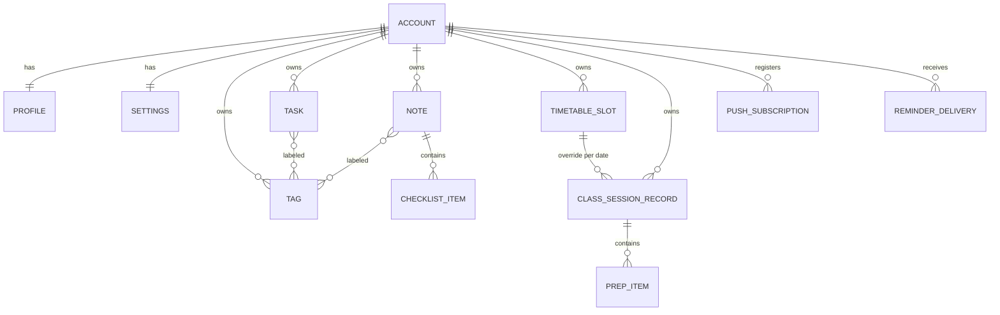

# BA Backend — CuteTeachy

- **Trạng thái:** Accepted — chốt qua phiên `/grill-with-docs` ngày 2026-10-24 (Q1–Q21).
- **Phạm vi:** toàn bộ nghiệp vụ của `CuteTeachy-BE`. Auth/Account/Profile/Onboarding/Avatar đã chi tiết ở [SPEC-002](../../../CuteTeachy-FE/docs/specs/SPEC-002-auth-google-onboarding-avatar.md); tài liệu này chỉ trỏ tới.
- **Thuật ngữ:** [`GLOSSARY.md`](../../../CuteTeachy-FE/GLOSSARY.md) (Account, Profile, Onboarding, Timetable Slot, Class Session, Reminder, …).
- **Quyết định kiến trúc:** [ADR 0001](../adr/0001-be-owned-auth.md) Auth do BE quản lý · [ADR 0002](../adr/0002-external-cron-reminders.md) Reminder qua cron ngoài · [ADR 0003](../adr/0003-mobile-first-sync.md) Đồng bộ mobile-first · [ADR 0004](../adr/0004-class-sessions-from-timetable.md) Class Session sinh từ Timetable Slot · [ADR 0005](../adr/0005-serverless-on-vercel.md) BE serverless trên Vercel.
- **Nguồn đã đối chiếu:** BRD/PRD trong `docs/ba/` và `CuteTeachy-FE/docs/ba/`, code FE (types, services, mock backend, schema validation, stores) tại thời điểm 2026-10-24.

## 1. Bối cảnh & ràng buộc

- Người dùng chính: giáo viên dùng **PWA trên điện thoại** (iOS/Android), phụ là laptop. Thiết kế API ưu tiên mobile: payload nhỏ, chịu được mất mạng, đồng bộ phần chênh lệch.
- Hosting miễn phí: Vercel serverless cho cả FE và BE ([ADR 0005](../adr/0005-serverless-on-vercel.md)), Cloudflare R2 cho file, Supabase cho Postgres. Gói miễn phí không cho lịch chạy định kỳ dày (Vercel Hobby cron chỉ 1 lần/ngày); BE không giữ trạng thái trong bộ nhớ giữa các request.
- Ngày (`YYYY-MM-DD`) và giờ (`HH:mm`) của Task/Class Session là **giờ địa phương** theo `timeZone` của giáo viên.
- Tính năng quan trọng nhất theo người dùng: **Reminder push** trên điện thoại.

## 2. Bản đồ miền

| Miền | Nội dung | Spec |
| --- | --- | --- |
| Auth & Profile | Account, Login Provider, token, Onboarding, Profile, Avatar | SPEC-002 |
| Settings | `locale`, `timeZone`, `pushEnabled`, `reminderLeadMinutes` | SPEC-003 (chuyển từ SPEC-005 vì `timeZone` cần trước Push) |
| Tasks | Việc cần làm theo ngày, có/không có giờ | SPEC-003 |
| Tags | Nhãn phân loại Task và Note | SPEC-003 |
| Notes | Ghi chú + checklist | SPEC-003 |
| Inspiration | Câu trích dẫn mỗi ngày (vi/en) | SPEC-003 |
| Timetable | Timetable Slot, Class Session (sinh từ slot, ghi đè từng buổi, buổi lẻ) | SPEC-004 |
| Reminders & Push | Thiết bị nhận push, tính & gửi Reminder | SPEC-005 |

`CLASS_SESSION_RECORD` = phần được lưu của Class Session: bản ghi đè cho một buổi sinh từ slot, hoặc một buổi lẻ (không có slot). Buổi không bị ghi đè **không** được lưu (xem ADR 0004).

## 3. Quy tắc chung (mọi miền nghiệp vụ)

| # | Quy tắc |
| --- | --- |
| G1 | Mọi dữ liệu thuộc đúng một giáo viên. Truy cập bản ghi của người khác → `404 not_found`. |
| G2 | Mọi route ngoài `/auth/*` yêu cầu Onboarding đã hoàn tất → nếu chưa: `403 onboarding_required` (SPEC-002). |
| G3 | **Client sinh UUID** cho bản ghi mới (Task, Tag, Note, Timetable Slot, Class Session lẻ, checklist/prep item) và gửi trong body. |
| G4 | Tạo **idempotent**: cùng `id` + cùng chủ → trả bản ghi hiện có (`200`); `id` đã bị xoá mềm → `410 gone`; `id` thuộc giáo viên khác → `409 id_conflict`. |
| G5 | Cập nhật theo **last-write-wins** theo thứ tự server nhận. Cập nhật bản ghi đã xoá → `404 not_found`. |
| G6 | **Xoá mềm**: bản ghi giữ dấu xoá 30 ngày rồi bị dọn hẳn. `DELETE` lặp lại → `204`. |
| G7 | **Đồng bộ chênh lệch**: danh sách nhận `?updatedSince=<ISO>`, trả các bản ghi thay đổi sau mốc đó + `deletedIds`. `updatedSince` cũ hơn 30 ngày → `400 validation` (client tải lại toàn bộ). |
| G8 | Dạng response danh sách: `{ items: T[], deletedIds: string[], nextCursor?: string, serverTime: ISODateTime }`. Client dùng `serverTime` làm `updatedSince` lần sau. |
| G9 | Lọc theo khoảng ngày (`from`, `to`, bao gồm hai đầu) tối đa **42 ngày** → vượt: `400 validation`. |
| G10 | Lỗi luôn có dạng `{ code, message }`. Mã mới ngoài SPEC-002: `id_conflict`, `gone`, `tag_name_taken`, `timetable_conflict`, `cannot_delete_generated_session`. |
| G11 | Giới hạn: tiêu đề ≤ 120, ghi chú Task ≤ 1000, nội dung Note ≤ 5000, tên Tag ≤ 24, checklist/prep ≤ 100 mục, ≤ 10 tag mỗi Task/Note. Mỗi `tagId` phải thuộc chính giáo viên → nếu không: `400 validation`. |
| G12 | Mỗi thay đổi gián tiếp (ví dụ xoá Tag gỡ khỏi Task) cũng cập nhật `updatedAt` của bản ghi bị ảnh hưởng để đồng bộ chênh lệch thấy được. |

## 4. Settings *(SPEC-003)*

| Trường | Kiểu | Mặc định | Ghi chú |
| --- | --- | --- | --- |
| `locale` | `'vi' \| 'en'` | theo `Accept-Language` lúc tạo Account, không có → `vi` | Ngôn ngữ nội dung push/email |
| `timeZone` | IANA | `Asia/Ho_Chi_Minh` | FE gửi trong Onboarding và khi đổi cài đặt; giá trị không hợp lệ → `400 validation` |
| `pushEnabled` | boolean | `true` | `false` → không gửi Reminder nào |
| `reminderLeadMinutes` | `5 \| 10 \| 15 \| 30 \| 60` | `15` | Đổi giá trị → tính lại thời điểm nhắc |

- Theme (`themePreference`) **vẫn chỉ lưu trên thiết bị** (ADR 0001 FE không đổi).
- Endpoint: `GET /me/settings`, `PATCH /me/settings` (từng phần).
- Thay thế mục Out of Scope "đồng bộ cài đặt" của SPEC-002 cho `locale` và push.

## 5. Tasks *(SPEC-003)*

**Trường:** `id`, `title`, `notes?`, `date`, `time?`, `category: 'school' | 'personal'`, `priority: 'normal' | 'high'` (mặc định `normal`), `tagIds`, `completed` (mặc định `false`), `createdAt`, `updatedAt`.

**Quy tắc:** không lặp lại (v1). Task có `time` và chưa `completed` mới sinh Reminder.

| Endpoint | Ghi chú |
| --- | --- |
| `GET /tasks?from&to[&updatedSince]` | G7–G9; `from`, `to` bắt buộc |
| `POST /tasks` | G3–G4, G11 |
| `PATCH /tasks/:id` | từng phần, G5 |
| `DELETE /tasks/:id` | G6 |

## 6. Tags *(SPEC-003)*

**Trường:** `id`, `name`, `tone: 'pink' | 'blue' | 'beige' | 'lavender' | 'rose' | 'mint'`, `updatedAt`.

**Quy tắc:**
- Tên không trùng trong phạm vi một giáo viên, so sánh không phân biệt hoa thường, sau khi trim → `409 tag_name_taken`.
- Xoá Tag → gỡ khỏi mọi Task và Note **trong cùng transaction** (G12).

| Endpoint | Ghi chú |
| --- | --- |
| `GET /tags[?updatedSince]` | không phân trang |
| `POST /tags` | G3–G4 |
| `PATCH /tags/:id` | đổi `name`, `tone` (mới so với FE hiện tại) |
| `DELETE /tags/:id` | G6 + gỡ liên kết |

## 7. Notes *(SPEC-003)*

**Trường:** `id`, `title`, `content?`, `checklist: { id, text, done }[]`, `imageUrl?` (chưa dùng ở v1), `tagIds`, `dueDate?`, `completed`, `createdAt`, `updatedAt`.

**Quy tắc:**
- `completed` do **BE quyết định** khi checklist không rỗng: `true` ⇔ mọi mục `done`; giá trị client gửi bị bỏ qua. Checklist rỗng → `completed` bật/tắt thủ công.
- Tìm kiếm **không dấu** (tiếng Việt, `đ` ≡ `d`), không phân biệt hoa thường, trên `title`, `content`, `text` của checklist.

| Endpoint | Ghi chú |
| --- | --- |
| `GET /notes?limit=20&cursor&q&tagId` | phân trang cursor, sắp `updatedAt` giảm dần; `limit` tối đa 50 |
| `GET /notes?updatedSince` | đồng bộ chênh lệch, không đi cùng `cursor`/`q`/`tagId` |
| `POST /notes` | G3–G4, G11 |
| `PATCH /notes/:id` | G5; gửi `checklist` là thay toàn bộ danh sách |
| `DELETE /notes/:id` | G6 |

## 8. Timetable Slot & Class Session *(SPEC-004, ADR 0004)*

### Timetable Slot
**Trường:** `id`, `weekday` (1 = Thứ Hai … 7 = Chủ nhật), `startTime`, `endTime` (cùng ngày, `start < end`), `subject`, `grade?`, `room?`, `tone`, `effectiveFrom`, `effectiveTo?`, `updatedAt`.

**Quy tắc:**
- Hai slot cùng `weekday`, khoảng giờ giao nhau, khoảng hiệu lực giao nhau → `409 timetable_conflict`.
- Sửa slot đã có buổi trong quá khứ (`effectiveFrom` < hôm nay theo `timeZone`) → BE **tách**: slot cũ `effectiveTo = hôm qua`, tạo slot mới hiệu lực từ hôm nay với giá trị mới. Slot chưa có buổi nào trong quá khứ → sửa tại chỗ.
- Xoá slot đã có buổi trong quá khứ → đặt `effectiveTo = hôm qua` (giữ lịch sử); chưa có → xoá mềm.

| Endpoint | Ghi chú |
| --- | --- |
| `GET /timetable-slots[?updatedSince]` | |
| `POST /timetable-slots` | G3–G4 |
| `PATCH /timetable-slots/:id` | trả `{ previous?, current }` — `previous` có khi xảy ra tách |
| `DELETE /timetable-slots/:id` | theo quy tắc trên |

### Class Session
**Trường response:** `id`, `timetableSlotId | null`, `date`, `startTime`, `endTime`, `subject`, `grade?`, `room?`, `tone`, `topic?`, `prepItems: { id, label, done }[]`, `cancelled`, `updatedAt`.

**Quy tắc:**
- Buổi sinh từ slot có `id` xác định từ (`timetableSlotId`, `date`), ổn định giữa các lần đọc.
- `topic`, `prepItems`, `cancelled` thuộc **từng buổi**; sửa chúng tạo/cập nhật bản ghi đè của buổi đó.
- **Buổi lẻ** (dạy bù/dạy thay): `timetableSlotId = null`, tạo bằng `POST`. Không kiểm tra trùng giờ với slot.
- Huỷ buổi: `cancelled = true` (vẫn trả về để UI hiển thị). Chỉ buổi lẻ được `DELETE`; buổi sinh từ slot → `400 cannot_delete_generated_session`.

| Endpoint | Ghi chú |
| --- | --- |
| `GET /class-sessions?from&to[&updatedSince]` | G9; khi có `updatedSince`: nếu có slot đổi sau mốc → trả toàn bộ khoảng, ngược lại chỉ buổi có bản ghi đè/buổi lẻ đổi |
| `POST /class-sessions` | tạo buổi lẻ, G3–G4 |
| `PATCH /class-sessions/:id` | `topic`, `prepItems`, `cancelled` (buổi lẻ sửa được mọi trường) |
| `DELETE /class-sessions/:id` | chỉ buổi lẻ |

## 9. Reminders & Push *(SPEC-005, ADR 0002)*

### Thiết bị nhận push
- Web Push chuẩn VAPID; iOS nhận được khi PWA đã thêm vào màn hình chính.
- `GET /push/vapid-public-key` (public) → `{ publicKey }`.
- `POST /push/subscriptions` `{ endpoint, keys: { p256dh, auth } }` → upsert theo `endpoint` (endpoint đang gắn Account khác → chuyển sang Account hiện tại). Một giáo viên nhiều thiết bị.
- `DELETE /push/subscriptions` `{ endpoint }` → 204. FE gọi khi đăng xuất.
- Gửi push nhận `404`/`410` từ push service → xoá subscription đó.

### Reminder
- Nguồn: Task có `time`, chưa `completed`, chưa xoá; Class Session chưa `cancelled`.
- Thời điểm nhắc = (`date` + `time`/`startTime` theo `timeZone`) − `reminderLeadMinutes`.
- Không nhắc khi `pushEnabled = false`.
- Mỗi Reminder gửi **đúng một lần** cho mỗi thời điểm nhắc: khoá idempotent gồm loại, `id` mục, thời điểm nhắc. Sửa giờ/đổi số phút → thời điểm mới → được nhắc theo giờ mới.
- Trễ **quá 10 phút** so với thời điểm nhắc → bỏ qua, không gửi muộn.
- Nội dung theo `locale`; bấm thông báo mở app tại ngày của mục. Mẫu câu chốt ở SPEC-005.

### Kích hoạt gửi
- `POST /internal/reminders/dispatch` — xác thực bằng secret trong header, không qua JWT/Onboarding guard. Cron ngoài gọi **mỗi phút**; trả `{ sent, skipped }`.
- Dev: lịch chạy trong BE gọi cùng use case.

## 10. Inspiration *(SPEC-003)*

- Danh sách cố định nạp bằng seed (vi + en, `author?`); nội dung ban đầu lấy từ mock seed của FE. Không có màn quản trị.
- `GET /inspirations/today` → chọn theo ngày trong năm tính theo `timeZone` của giáo viên.

## 11. Thay đổi FE kéo theo

| Hạng mục | Hiện trạng FE | Cần đổi |
| --- | --- | --- |
| Tạo mới | Server sinh id | Client sinh UUID (G3), xử lý `410 gone` |
| Danh sách | Mảng thuần | Envelope G8, đồng bộ `updatedSince`, xoá theo `deletedIds` |
| Notes | Tải hết, tìm/lọc ở client | Cursor + infinite scroll, tìm/lọc qua BE |
| Note `completed` | FE tự tính | Lấy từ response BE |
| Tags | Không sửa được | Màn sửa tên/màu, `409 tag_name_taken` |
| Classes | Chỉ đọc, `room` bắt buộc | Màn Timetable Slot + Class Session (thêm/sửa/huỷ/buổi lẻ), `room` tùy chọn, `cancelled`, `timetableSlotId` |
| Settings | `locale`, `pushNotifications` chỉ trên thiết bị | Đồng bộ qua `/me/settings`, thêm `timeZone`, `reminderLeadMinutes` |
| Push | Service worker chưa xử lý `push` | Xin quyền, đăng ký subscription, xử lý `push` + `notificationclick` |

## 12. Ngoài phạm vi v1

Xoá tài khoản & xuất dữ liệu · trang quản trị · chia sẻ giữa giáo viên · nhập/xuất Google Calendar · Task lặp lại · upload ảnh cho Note · endpoint tổng hợp dashboard · đặt mật khẩu cho Account chỉ có Google (SPEC-002).

## 13. Thông tin còn thiếu

Đã chốt nhà cung cấp (chi tiết cách lấy cấu hình: [`docs/setup/external-services.md`](../setup/external-services.md)): lưu file production = Cloudflare R2 (dev MinIO), email = Gmail SMTP + App Password (dev Mailpit), cron = cron-job.org. Còn chờ người dùng tạo và đặt vào biến môi trường:

- `[CẦN BỔ SUNG]` Google OAuth client ID/secret.
- `[CẦN BỔ SUNG]` Gmail gửi mail + App Password.
- `[CẦN BỔ SUNG]` Bucket R2, API token, URL công khai.
- `[CẦN BỔ SUNG]` Cặp khoá VAPID production + email liên hệ.
- `[CẦN BỔ SUNG]` `CRON_SECRET` và job trên cron-job.org (sau khi BE deploy).

## 14. Bước tiếp theo

Đã tách thành spec (trong `CuteTeachy-FE/docs/specs/`): SPEC-003 (Tasks + Tags + Notes + Inspiration + Settings + đồng bộ), SPEC-004 (Timetable), SPEC-005 (Push + Reminder). Tiếp theo: `/to-tickets` cho từng spec và điều phối như `CuteTeachy-FE/.scratch/auth-profile/ORCHESTRATION.md`.
